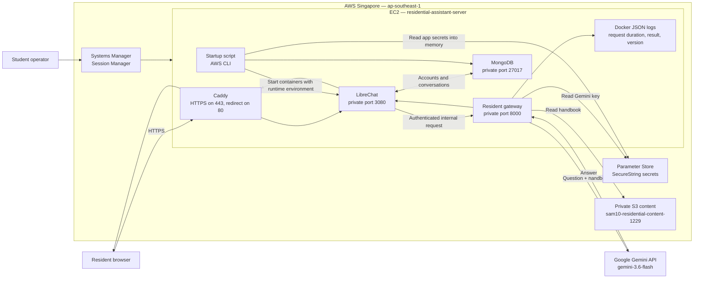

# AWS Infrastructure Design

Initial deployment, November 8, 2026. Based on deployment configuration, launch-form screenshots, service-health output, runtime access tests, and the student's successful browser chat. Final running-instance security and storage settings still need auditing. This diagram describes the current application; CloudWatch ingestion, alarms, backup jobs, and scheduled checks are not yet implemented.

Only Caddy publishes app-stack host ports. MongoDB uses a dedicated application user. The runtime EC2 role supplies AWS credentials; no static AWS access key is included in the bundle. Model-provider authentication is handled by the gateway using the Gemini parameter. The handbook and model key are cached in memory for up to 60 seconds. JSON request logs are written to the gateway container's stdout with local Docker rotation.

The hostname is residential-assistant.54.179.56.26.sslip.io. sslip.io supplies DNS, and Caddy obtained a public certificate. Certificate data is retained in the existing named Caddy volume. The documentation website will be a separate GitHub Pages deployment.

A single host was chosen to keep cost and operational scope manageable. This is a deliberate availability trade-off: failure of that host interrupts the app and database. The next priority is detecting failure and proving recovery.
